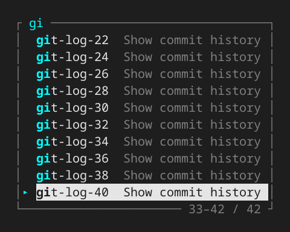

# Configuration

For installation and shell loading, see [installation.md](installation.md).

The configuration file is read from `$XDG_CONFIG_HOME/zacrs/config.toml`, or
`~/.config/zacrs/config.toml` when `XDG_CONFIG_HOME` is not set.

## Popup appearance

The popup uses the terminal's background and foreground, with ANSI cyan for the
filter label and matched characters. Matches are also bold; selected rows retain
their selection colors and use bold alone for matches. A cyan `▸` marks the
selected row in a separate gutter. The border uses ANSI dark grey. When some
candidates are outside the visible area, the bottom border shows the visible
range, for example `1–10 / 42`. The marker and range are omitted when the terminal
is too narrow to fit them.



Override colors in the `[theme]` table:

```toml
[theme]
filter = "cyan"
match = "cyan"
selected-marker = "cyan"
border = "dark-grey"
description = "dark-grey"
# candidate = "white"
# selected-fg = "black"
# selected-bg = "cyan"
```

Colors accept ANSI names, `ansi:0` through `ansi:255`, `rgb:255,128,0`, or
`default` for the terminal's default color. Set `filter`, `match`,
`selected-marker`, and `border` to `default` for a neutral palette with bold
match emphasis.

Setting `NO_COLOR` disables colors while preserving bold match emphasis.

## Candidate order

With a nonempty query, candidates are ordered by matching score, shorter
candidate text, kind priority, then text. With an empty query, kind priority
comes first, followed by shorter text and text order.

Customize kind priority in `[completion]`. This is the default order:

```toml
[completion]
kind_order = ["directory", "file", "abbreviation", "command", "alias", "builtin", "function", "other"]
```

Earlier entries have higher priority. Omitted kinds follow the listed ones in
their default order; `kind_order = []` and omitting the setting both use the
default. For example, `kind_order = ["command"]` puts commands first for empty
queries and equal-score/equal-length matches. To prefer commands over
abbreviations while keeping paths first, use
`kind_order = ["directory", "file", "command"]`.

`other` groups all remaining candidate kinds, including options and candidates
without a kind. Typo-rescue candidates use their base kind, such as `command`.
Unknown names, repeated names, and non-string entries make the configuration
invalid. A running daemon keeps its last valid settings; an initial load falls
back to defaults. Changes apply to subsequent requests, including cached native
candidates, while an open interactive popup retains its starting order.

This setting changes only kind priority. It does not override a better matching
score or shorter text, or change which abbreviations are eligible in the
current context. The default keeps paths first at empty argument positions such
as `nvim <Tab>` and `mv <Tab>`; explicitly putting `abbreviation` first also
prioritizes eligible argument abbreviations there.

## Abbreviations

Static abbreviations are portable completion candidates. By default they are
offered only at command position. Expansions are inserted literally without
running shell evaluation while candidates are being gathered or displayed.

Abbreviations use the same matching score as other candidates. For equal scores
and text lengths, the default kind order is directories, files, abbreviations, then
commands and other native candidates. For example, an abbreviation
`mkdir = "mkdir -p"` appears before the `mkdir` command for both `mkd` and
`mkdir`. Better matches and shorter candidate text still take precedence.
With an empty query, the default kind order keeps paths before abbreviations,
including at argument positions such as `nvim <Tab>` and `mv <Tab>`.

For simple entries, use the `[abbreviations]` table:

```toml
[abbreviations]
gs = "git status"
```

For a description or explicit cursor placement, use `[[abbreviation]]`:

```toml
[[abbreviation]]
trigger = "gcm"
expansion = "git commit -m '{{cursor}}'"
description = "commit with a message"
```

Shell fragments can use the same format:

```toml
[[abbreviation]]
trigger = "null"
expansion = ">/dev/null"
description = "discard stdout"
when.position = "any"
```

`when.position = "any"` also offers the abbreviation at argument positions. Typing
`cargo test <Tab>` can then show `null`, and `cargo test null<Tab>` can replace
`null` with `>/dev/null`. The supported positions are `command` (the default)
`argument`, and `any`.

Use `when.command` to restrict an abbreviation to the current simple-command
context. It accepts one glob or a list of alternative globs:

```toml
[[abbreviation]]
trigger = "null"
expansion = ">/dev/null"
description = "discard stdout"
when.position = "argument"
when.command = ["cargo *", "cross *", "git add *"]
```

The shell normalizes parsed words to one space and matches only the simple
command containing the cursor, so `echo ok | cargo test null` is matched as
`cargo test null`. Matching is case-sensitive and anchored to the entire
context. Patterns support `*`, `?`, and character classes such as `[abc]`.
They are compiled when configuration is loaded and are never expanded or
executed by the shell. Position and command conditions are combined with AND;
entries in the command list are combined with OR.

`{{cursor}}` is removed during insertion and places the cursor at that position.
Only one cursor marker is supported per expansion.

The popup description always starts with the literal expansion preview. When a
custom `description` is configured, it is shown after the preview.

When an abbreviation is selected in the popup:

- Enter expands it and accepts the command line.
- Space expands it, appends a space, and keeps editing the command line.
- Cancel leaves the command line unchanged.

Defining abbreviations does not install key bindings, widgets, hooks, aliases,
functions, or traps. The shell adapter remains responsible for presenting and
applying completion results.

Both the daemon and subprocess paths read the same configuration. A running
daemon checks the file's modification time and size on existing requests and
applies changes to subsequent completion sessions. An interactive popup retains
the settings it started with. There is no file watcher, additional shell hook,
or per-keystroke configuration request.

If the file contains invalid TOML, cannot be read, or temporarily disappears while
being saved, the daemon keeps the last successfully loaded settings. Invalid TOML
is logged once per file version and retried when the file changes; I/O failures
are retried on subsequent requests. Without a successfully loaded file, defaults
are used. To restore defaults, save an empty file. Removing the file keeps the
running daemon's current settings until it restarts or a valid file reappears.

Abbreviations are added to native candidates using the current configuration on
each request, including requests that reuse cached native candidates. The configured
kind order applies to these candidates too. The Zsh initialization setting
for optional Enter expansion below still requires a plugin reload.

### Optional expansion on Enter (Zsh)

To expand an exact command abbreviation when accepting a line, add this to
`config.toml`:

```toml
[completion]
expand_abbreviation_on_enter = true
```

This replaces the former `ZACRS_ABBR_EXPAND_ON_ENTER` shell variable, which is
no longer read. Reload the plugin after changing this setting. Configuration is
received through the daemon's startup handshake. When disabled, no abbreviation
editing session is registered and Enter sends no abbreviation request.

It is disabled by default. With `gs = "git status"`, typing `gs` then Enter
rewrites the input to `git status` and executes it; `gs -sb` becomes
`git status -sb`. History records the expanded command. A same-named executable
or alias is overridden by the configured abbreviation in this mode. Space
keeps its ordinary behavior.

The Zsh adapter obtains a command-word range from the native completion parser.
It offers that range only when the parser's command words cover the complete
lexical input and native literal quoting leaves the word unchanged. Native
reserved words are excluded. Partial triggers, quoted/escaped words, command
words containing substitutions or patterns, assignment prefixes, command lists,
function declarations, and continuation input are left as typed. Variables in
arguments do not prevent expansion. A path such as `./gs`
does not match the trigger `gs`. Redirections are currently left unchanged
because this query cannot verify their full context.
Command-position and `when.command` conditions still apply;
argument-position abbreviations continue to require popup selection.

An expansion with `{{cursor}}` replaces the command word and leaves the line in
the editor at the marker instead of executing it. Arguments and surrounding
whitespace are preserved. Editing the resulting arguments and pressing Enter
executes that prepared command without expanding it again, even if its name is
also an abbreviation trigger (for example, `ssh = "ssh user@{{cursor}}"`).
Expansion happens once per Enter, and a candidate
explicitly selected in the popup is accepted without a second expansion.
This also applies after selecting with Space and editing arguments. The choice
is compared with the command word when selecting another candidate or accepting
the line. Returning to the same selected word during the same input line keeps
its protection; intermediate keystrokes are not tracked. A different final word
or a new input line clears the exemption.
Closing the popup with Space after typing a filter without selecting a candidate
keeps that typed command eligible for Enter expansion.

When enabled, the daemon owns the editing session and selection protection.
Zsh sends facts only when applying a candidate or accepting a line, and resets the
session when ZLE starts a new input line. It holds no abbreviation selection state
or edit journal and sends no per-redraw abbreviation observations. These requests
use the existing Unix socket and launch no helper processes. The Zsh adapter uses
the existing completion widget in context-only mode to verify the target and supplies
its literal word and character range. Rust validates the range and performs
exact lookup and editing without parsing shell syntax. This widget runs only
when Enter expansion is enabled and calls no candidate providers. No extra
completion widget is registered. The query temporarily places the cursor at the
end of the command word, then restores the editor state before applying any edit.
Other shell adapters must establish their own native context capability; there is no
shared Zsh grammar heuristic.

If the plugin is first enabled inside an active ZLE widget, it initializes that
line immediately with one reset request. Reloading preserves an initialized
session and its explicit selection protection. Reloading an older adapter also
leaves any existing session untouched. This does not make the feature available
before the plugin has loaded.

Enter expansion requires a compatible running daemon. If transport fails, the
original input is preserved and expansion stays disabled for the current line.
The existing line-init hook reconnects and resets the editing session on the
next fresh line. Malformed responses disable expansion until plugin reload.
If the daemon restarts or loses the editing session, the current input is left
unchanged; a fresh line starts a new session. Literal shell expressions
in expansions are evaluated by Zsh only when the resulting line is executed.

### Daemon updates

After successfully switching the installed zacrs executable, the installer or
package activation must run the newly installed executable with `daemon stop`.
Stop only when the zacrs package changes, including rollbacks; unrelated package
or configuration updates should not stop the daemon. For Home Manager, run this
after package installation, never inside a package build. Other package managers
can use their post-upgrade hook. Installation does not start a replacement daemon
in the installer's environment.

`daemon stop` is idempotent and waits for the listening socket to be released.
Existing popup sessions can finish on their open connections. A subsequent shell
initialization or completion request starts a daemon with the shell's environment.
Normal shell startup reuses a running daemon and retrieves capabilities; it does
not search PATH to compare binaries, compute build fingerprints, or inspect
executable metadata. `daemon ensure` serializes startup when a daemon is missing;
it does not replace a running daemon. `daemon retire` remains an alias for stop
for older update hooks.

The installer or package activation owns this stop; zacrs cannot automatically
run it for arbitrary installation methods. Manual installs and symlink changes
require an explicit `daemon stop` after switching the installed executable.
Stopping the daemon does not reload shell code in existing shells; restart the
shell when an update changes the shell/daemon protocol incompatibly.
Settings continue to hot-reload without restarting the process. Existing shells
may temporarily lose completion when the daemon stops. Enter expansion preserves
the current input and reconnects at the next line through its existing line-init
hook. No extra hook, polling or per-keystroke health check is installed. Malformed
responses still require plugin reload.

See [the shell adapter boundary](shell-adapters.md) for the context contract.
